# GSB (Good Standing Bridge)

**서비스 설명:** 체류자격별 금융정보·은행 요건 대조 기반 계좌 명의대여 사기 예방 서비스 | Evidence-based Financial Fraud Prevention for Migrants (Next.js · React · TypeScript)

- **배포**: [gsb-virid.vercel.app](https://gsb-virid.vercel.app/)
- **기술**: Next.js 16, React 19, TypeScript
- **언어**: 한국어·영어
- **형태**: 회원가입 없이 데모 프로필로 체험하는 단일 페이지 앱

## 주요 기능

1. **체류자격별 금융 정보** — 우즈베키스탄·베트남·필리핀 데모 프로필을 선택하면 체류자격과 남은 기간에 따라 지금 가능한 금융 서비스, 추가 조건이 필요한 서비스, 이용하기 어려운 서비스를 확인합니다.
2. **명의대여 위험 진단** — 은행이 보는 정보와 실제 상황, 대포통장 명의자 패턴을 비교하고 명의대여로 생길 수 있는 법적·금융상 결과를 설명합니다.
3. **은행별 준비 경로** — 공개된 은행 안내와 프로필 정보를 바탕으로 통과 가능성이 높은 순서와 충족·미충족 요건, 준비 서류 체크리스트를 보여줍니다. 결과는 참고용 가능성 안내이며 은행의 승인 판단이 아닙니다.
4. **메시지 사기 판별** — 받은 제안 문장을 붙여넣거나 예시를 선택하면 위험 신호를 표시합니다. 규칙 기반으로 위험도를 판정하고, 설정에 따라 Claude가 판정 근거 설명을 생성합니다.

## 화면 미리보기

캡처 이미지는 `public/capture/`에 있으며, 아래 이미지는 저장소의 캡처 파일을 그대로 표시합니다.

### 1. 시작 — 데모 프로필과 금융 좌표

프로필을 선택하고 등록증 인식 시연을 마치면, 해당 체류자격으로 가능한 금융 업무와 조건을 확인합니다.

<p>
  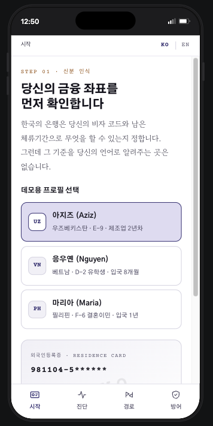
  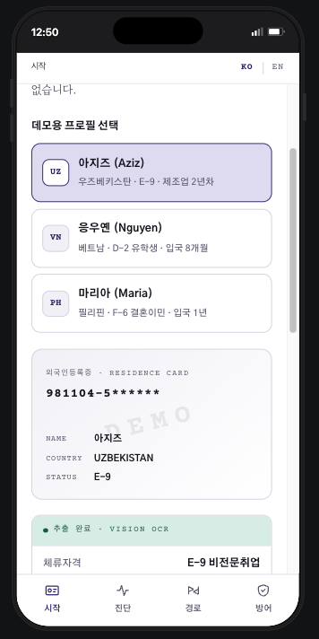
  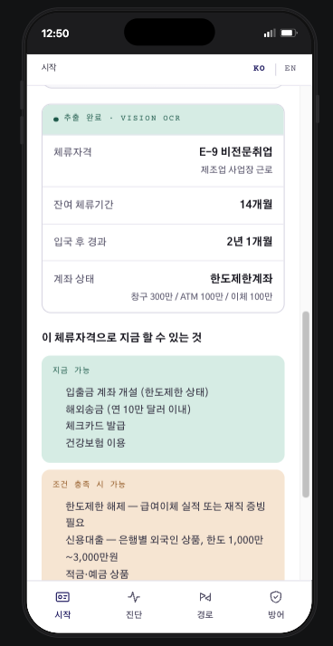
  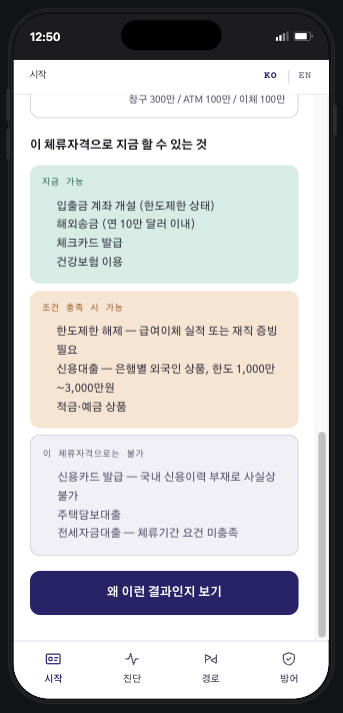
</p>

### 2. 진단 — 은행이 보는 나와 실제 나

은행의 확인 기준과 명의대여 계좌가 악용되는 패턴을 비교해 위험과 법적 효과를 안내합니다.

<p>
  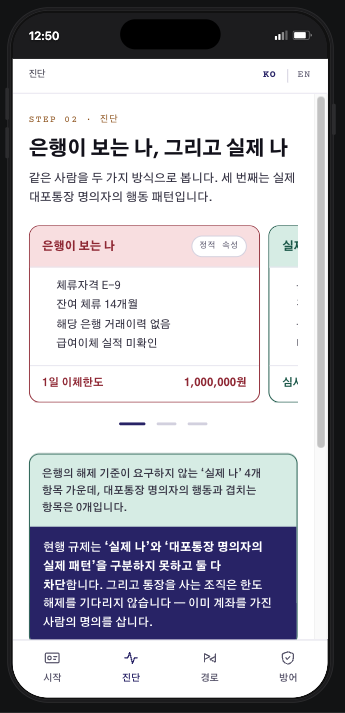
  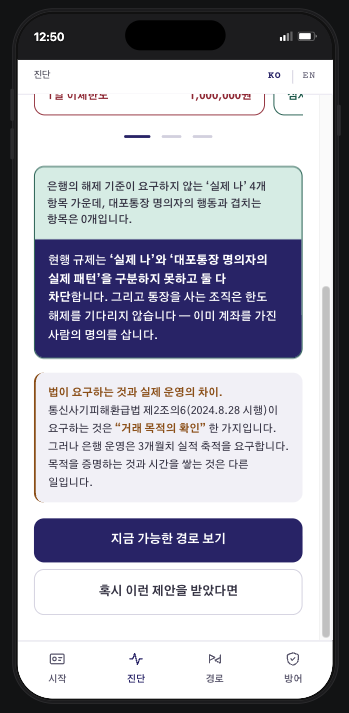
</p>

### 3. 경로 — 은행별 요건과 준비 서류

은행별 공개 정보에 따른 가능성 순위, 요건 상세, 서류 체크리스트를 확인합니다.

<p>
  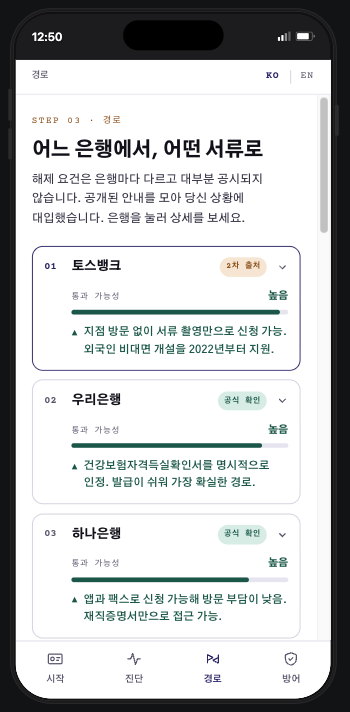
  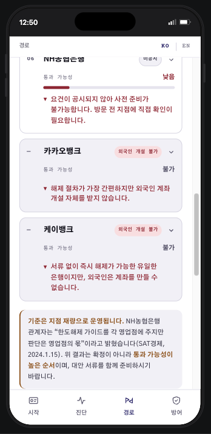
  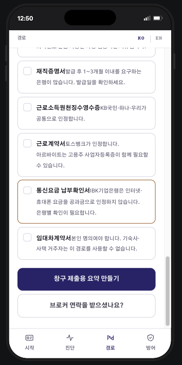
</p>

### 4. 방어 — 받은 메시지 확인

문장을 붙여넣어 분석하면 위험 판정과 근거가 표시되고, 원문 속 의심 문구를 확인할 수 있습니다.

<p>
  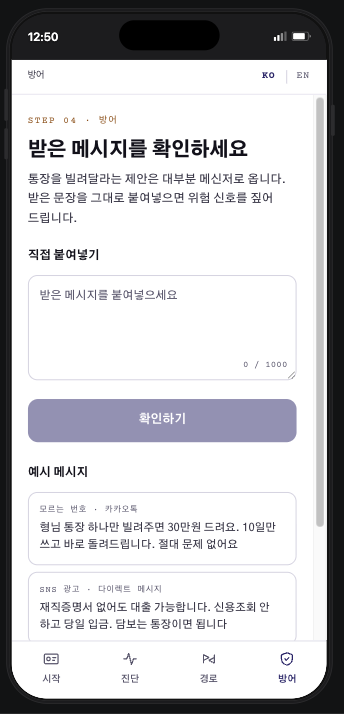
  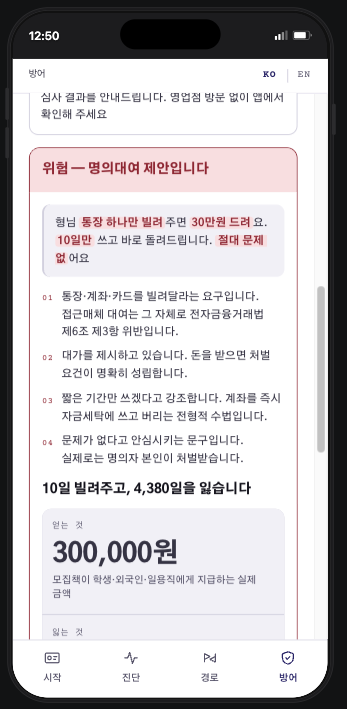
</p>

## 구현 범위와 한계

- 등록증 화면은 실제 신분증이 아닌 **데모 목업**입니다. 현재 인식 애니메이션과 결과는 선택한 프리셋 데이터로 시연합니다.
- **사용자 사진 업로드와 실제 OCR은 구현되어 있지 않습니다.** 캡처에 보이는 “Vision OCR”은 프리셋 데이터가 표시되는 데모 화면입니다.
- 서류 체크리스트는 화면 내에서 상태를 선택하는 기능입니다. 창구 제출용 파일을 생성하거나 서류 사진을 업로드하지 않습니다.
- 은행별 정보와 가능성 표시는 참고 자료입니다. 실제 요건과 승인 여부는 은행 및 지점에서 확인해야 합니다.
- 메시지 판별은 확정적인 법률 판단이 아닙니다. 규칙 엔진이 기본 판정을 내리고, API 키와 Origin 설정이 허용될 때만 AI 설명을 사용할 수 있습니다.

## 로컬 실행

```bash
npm install
cp .env.example .env.local
npm run dev
```

브라우저에서 [http://localhost:3000](http://localhost:3000)을 여세요. `ANTHROPIC_API_KEY`가 없어도 앱은 실행되며 메시지 분석은 fallback 경로를 사용합니다.

## 환경 변수

| 변수 | 설명 | 기본값 |
|---|---|---|
| `ANTHROPIC_API_KEY` | 설정하면 허용된 요청에서 Claude 설명 생성에 사용 | 없음 |
| `GSB_MODEL` | 사용할 Claude 모델 | `lib/prompt.ts`의 `DEFAULT_MODEL` |
| `GSB_ALLOWED_ORIGINS` | AI 호출을 허용할 Origin 목록. 목록 밖 요청은 fallback으로 처리 | 없음 |

## 명령어

```bash
npm run dev     # 개발 서버
npm run build   # 프로덕션 빌드
npm run lint    # ESLint
npm test        # Jest 테스트
```

자세한 AI 판정 동작은 [`AI_SIGNAL_FEATURE_SPEC.md`](AI_SIGNAL_FEATURE_SPEC.md)와 [`AI_SIGNAL_IMPLEMENTATION.md`](AI_SIGNAL_IMPLEMENTATION.md)를 참고하세요.
